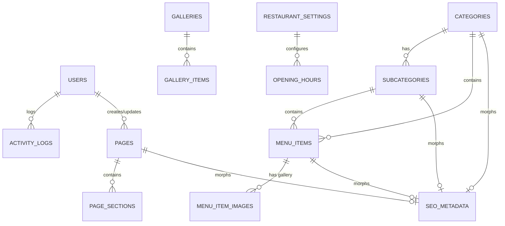

# Database Schema & Entity Relationships

This document details the normalized relational database schema designed for the Restaurant Website, CMS, and Restaurant Management System.

---

## 1. Entity Relationship Diagram (ERD)

---

## 2. Table Specifications

### 2.1 Core & Authentication
- **`users`**:
  - `id` (BIGINT, PK)
  - `name` (VARCHAR), `email` (VARCHAR, UNIQUE), `password` (VARCHAR)
  - `avatar` (VARCHAR, NULLABLE), `phone` (VARCHAR, NULLABLE)
  - `is_active` (BOOLEAN, default: 1)
  - `remember_token`, `timestamps`, `deleted_at` (SoftDeletes)
- **`roles` / `permissions` / `model_has_roles` / `role_has_permissions`**:
  - Spatie Laravel-Permission relational tables for granular RBAC.

### 2.2 CMS & Page Builder
- **`pages`**:
  - `id` (BIGINT, PK)
  - `title` (VARCHAR 255), `slug` (VARCHAR 255, UNIQUE)
  - `template` (VARCHAR 100, default: 'default')
  - `featured_image` (VARCHAR, NULLABLE)
  - `excerpt` (TEXT, NULLABLE), `content` (LONGTEXT, NULLABLE)
  - `status` (ENUM: 'draft', 'published', 'archived')
  - `sort_order` (INT, default: 0)
  - `published_at` (TIMESTAMP, NULLABLE)
  - `created_by` (BIGINT FK -> users.id, NULLABLE)
  - `updated_by` (BIGINT FK -> users.id, NULLABLE)
  - `timestamps`, `deleted_at` (SoftDeletes)
- **`page_sections`**:
  - `id` (BIGINT, PK)
  - `page_id` (BIGINT FK -> pages.id, CASCADE on delete)
  - `section_type` (VARCHAR 100, e.g., 'hero', 'food-grid', 'cta')
  - `sort_order` (INT, default: 0)
  - `data` (JSON / LONGTEXT: stores title, subtitle, images, buttons, items)
  - `is_active` (BOOLEAN, default: 1)
  - `timestamps`

### 2.3 Restaurant & Menu Management
- **`categories`**:
  - `id` (BIGINT, PK)
  - `name` (VARCHAR 255), `slug` (VARCHAR 255, UNIQUE)
  - `description` (TEXT, NULLABLE), `image` (VARCHAR, NULLABLE)
  - `status` (ENUM: 'active', 'inactive')
  - `sort_order` (INT, default: 0)
  - `timestamps`, `deleted_at` (SoftDeletes)
- **`subcategories`**:
  - `id` (BIGINT, PK)
  - `category_id` (BIGINT FK -> categories.id, CASCADE on delete)
  - `name` (VARCHAR 255), `slug` (VARCHAR 255)
  - `description` (TEXT, NULLABLE), `image` (VARCHAR, NULLABLE)
  - `status` (ENUM: 'active', 'inactive')
  - `sort_order` (INT, default: 0)
  - `timestamps`, `deleted_at` (SoftDeletes)
  - *Index: UNIQUE on `(category_id, slug)`*
- **`menu_items`**:
  - `id` (BIGINT, PK)
  - `category_id` (BIGINT FK -> categories.id)
  - `subcategory_id` (BIGINT FK -> subcategories.id, NULLABLE)
  - `name` (VARCHAR 255), `slug` (VARCHAR 255, UNIQUE)
  - `short_description` (VARCHAR 500, NULLABLE)
  - `full_description` (TEXT, NULLABLE)
  - `price` (DECIMAL 10,2)
  - `discounted_price` (DECIMAL 10,2, NULLABLE)
  - `primary_image` (VARCHAR, NULLABLE)
  - `ingredients` (JSON / LONGTEXT, NULLABLE)
  - `allergens` (JSON / LONGTEXT, NULLABLE)
  - `calories` (INT, NULLABLE), `preparation_time` (INT in minutes, NULLABLE), `serving_size` (VARCHAR 100, NULLABLE)
  - `is_vegetarian` (BOOLEAN, default: 0)
  - `is_vegan` (BOOLEAN, default: 0)
  - `is_spicy` (BOOLEAN, default: 0)
  - `is_featured` (BOOLEAN, default: 0)
  - `is_available` (BOOLEAN, default: 1)
  - `status` (ENUM: 'active', 'inactive')
  - `sort_order` (INT, default: 0)
  - `tags` (JSON, NULLABLE)
  - `timestamps`, `deleted_at` (SoftDeletes)
- **`menu_item_images`**:
  - `id` (BIGINT, PK), `menu_item_id` (FK -> menu_items.id, CASCADE)
  - `image_path` (VARCHAR), `sort_order` (INT, default: 0)
  - `timestamps`

### 2.4 Media Library
- **`media`**:
  - `id` (BIGINT, PK)
  - `filename` (VARCHAR 255), `original_filename` (VARCHAR 255)
  - `path` (VARCHAR 500), `disk` (VARCHAR 50, default: 'public')
  - `mime_type` (VARCHAR 100), `size` (BIGINT unsigned, bytes)
  - `width` (INT, NULLABLE), `height` (INT, NULLABLE)
  - `alt_text` (VARCHAR 255, NULLABLE), `title` (VARCHAR 255, NULLABLE), `caption` (TEXT, NULLABLE)
  - `timestamps`, `deleted_at` (SoftDeletes)

### 2.5 SEO & Redirection
- **`seo_metadata`**:
  - `id` (BIGINT, PK)
  - `seoable_type` (VARCHAR 255), `seoable_id` (BIGINT unsigned)
  - `meta_title` (VARCHAR 255, NULLABLE), `meta_description` (TEXT, NULLABLE)
  - `canonical_url` (VARCHAR 500, NULLABLE), `robots` (VARCHAR 100, default: 'index, follow')
  - `og_title` (VARCHAR 255, NULLABLE), `og_description` (TEXT, NULLABLE), `og_image` (VARCHAR 500, NULLABLE)
  - `twitter_title` (VARCHAR 255, NULLABLE), `twitter_description` (TEXT, NULLABLE), `twitter_image` (VARCHAR 500, NULLABLE)
  - `schema_override` (JSON, NULLABLE)
  - `timestamps`
  - *Morph Index: `(seoable_type, seoable_id)`*
- **`redirects`**:
  - `id` (BIGINT, PK)
  - `old_url` (VARCHAR 500, UNIQUE)
  - `new_url` (VARCHAR 500)
  - `status_code` (INT: 301 or 302, default: 301)
  - `is_active` (BOOLEAN, default: 1)
  - `hits` (BIGINT, default: 0)
  - `last_accessed_at` (TIMESTAMP, NULLABLE)
  - `timestamps`

### 2.6 Operations & Customer Communications
- **`opening_hours`**:
  - `id` (BIGINT, PK)
  - `day_of_week` (ENUM: 'monday' ... 'sunday')
  - `open_time` (TIME, NULLABLE), `close_time` (TIME, NULLABLE)
  - `second_open_time` (TIME, NULLABLE), `second_close_time` (TIME, NULLABLE)
  - `is_closed` (BOOLEAN, default: 0)
  - `timestamps`
- **`contact_messages`**:
  - `id` (BIGINT, PK)
  - `name` (VARCHAR 255), `email` (VARCHAR 255), `phone` (VARCHAR 50, NULLABLE)
  - `subject` (VARCHAR 255, NULLABLE), `message` (TEXT)
  - `ip_address` (VARCHAR 45, NULLABLE), `user_agent` (VARCHAR 500, NULLABLE)
  - `is_read` (BOOLEAN, default: 0), `is_archived` (BOOLEAN, default: 0)
  - `read_at` (TIMESTAMP, NULLABLE)
  - `timestamps`, `deleted_at` (SoftDeletes)
- **`settings`**:
  - `id` (BIGINT, PK)
  - `group` (VARCHAR 100, e.g., 'general', 'branding', 'contact', 'social', 'seo')
  - `key` (VARCHAR 100, UNIQUE)
  - `value` (LONGTEXT, NULLABLE), `type` (VARCHAR 50, default: 'text')
  - `timestamps`
- **`activity_logs`**:
  - `id` (BIGINT, PK)
  - `user_id` (BIGINT FK -> users.id, NULLABLE)
  - `action` (VARCHAR 100: 'created', 'updated', 'deleted', 'published')
  - `subject_type` (VARCHAR 255, NULLABLE), `subject_id` (BIGINT, NULLABLE)
  - `description` (VARCHAR 500)
  - `properties` (JSON, NULLABLE)
  - `ip_address` (VARCHAR 45, NULLABLE)
  - `timestamps`
